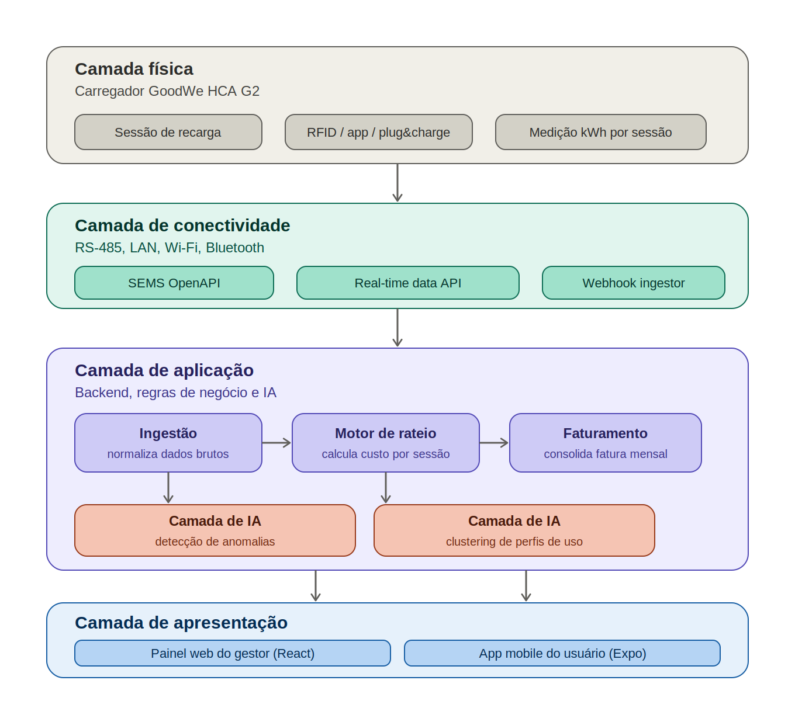
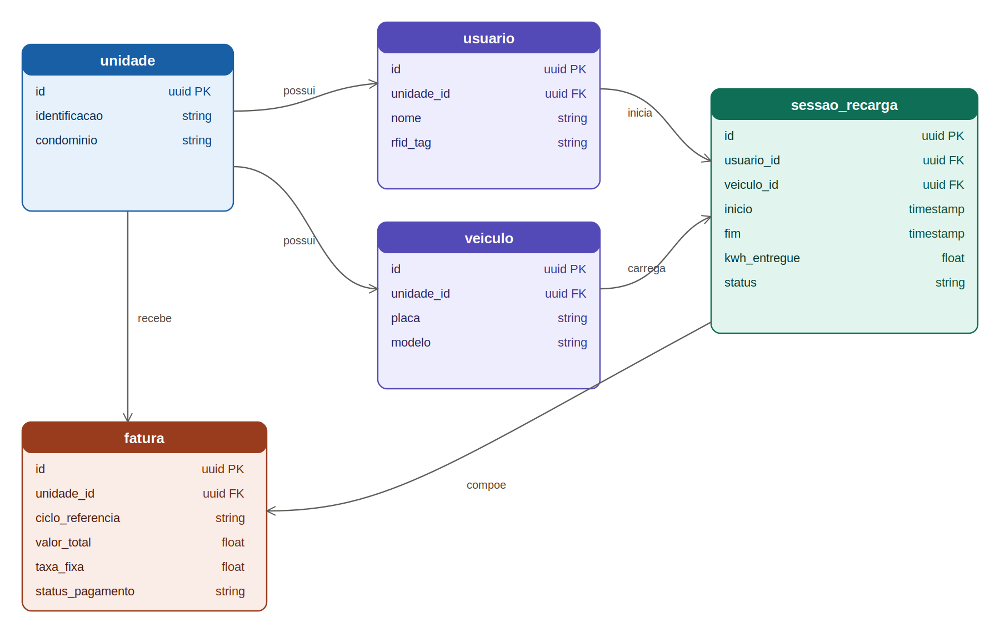

# EV ChargeOps

Sprint 1: Enterprise Challenge 2026 (GoodWe + FIAP)

## Equipe

| Integrante | RM |
|---|---|
| Arthur Barbosa de Morais | rm573731 |


## 1. O problema

A GoodWe opera, em parceria com a FIAP, um carregador de veículos elétricos (modelo HCA G2) instalado no Energy Innovation Lab, na unidade Aclimação. Esse equipamento é o ponto de partida para um problema mais amplo: infraestruturas de recarga compartilhada, em condomínios, prédios corporativos e campi universitários, não têm hoje mecanismos integrados para estruturar sessões por usuário, calcular consumo individual, aplicar rateio justo e oferecer uma experiência digital clara tanto para quem usa quanto para quem administra.

Isso não é um problema hipotético. À medida que a frota de elétricos cresce, o gargalo se desloca da disponibilidade de carregadores para a gestão de quem usa o quê, quando e quanto deve pagar por isso. Um condomínio com um único carregador compartilhado em 50 vagas não tem como saber, sem instrumentação adequada, se o rateio simples do custo entre todos os moradores é justo para quem nunca carrega ou se o usuário mais frequente está sendo subsidiado pelos demais.

O EV ChargeOps parte da premissa de que cada sessão de recarga já gera os dados necessários para resolver esse problema: duração, energia entregue, horário, frequência. O que falta é estruturar esses dados em um fluxo que vá da sessão bruta até uma fatura individual justificável, com inteligência artificial atuando como camada de análise sobre esse fluxo, não como recurso decorativo.

### Por que a frota de elétricos no Brasil torna isso urgente

O ritmo de adoção de veículos elétricos no Brasil acelerou de forma acentuada nos últimos dois anos. Em 2025, o mercado brasileiro de veículos leves eletrificados fechou o ano com 223.912 unidades vendidas, recorde da série histórica. O início de 2026 superou esse ritmo: fevereiro registrou 24.885 emplacamentos, crescimento de 92% sobre o mesmo mês de 2025, e abril chegou a 38.516 unidades, equivalente a 16,2% de todas as vendas de automóveis e comerciais leves do país no mês, contra praticamente metade dessa participação sete meses antes. A frota acumulada de eletrificados no Brasil já passa de 700 mil veículos, com os modelos 100% elétricos (BEV) respondendo por mais de um terço dos emplacamentos de 2026.

Esse crescimento concentra-se em poucos estados. São Paulo lidera com folga a frota nacional, seguido por Distrito Federal, Rio de Janeiro, Minas Gerais e Paraná, o que indica que a pressão sobre garagens de condomínios e estacionamentos corporativos nessas regiões vai se intensificar antes de se espalhar de forma uniforme pelo país. A rede de recarga pública não acompanha esse ritmo no mesmo grau: o levantamento mais recente da ABVE contabilizava cerca de 16.880 eletropostos públicos e semipúblicos no Brasil, a maior parte de corrente alternada. Isso reforça por que a recarga compartilhada em garagens privadas, e não a recarga pública, é o ponto de maior atrito operacional hoje.

## 2. Frente 1: contexto e problema

### O que é recarga compartilhada e quais são os desafios operacionais

Recarga compartilhada é qualquer infraestrutura de carregamento de veículos elétricos cujo uso não é exclusivo de uma única unidade consumidora. Um ou mais carregadores atendem múltiplos usuários (moradores, funcionários, frequentadores) que precisam ser identificados, ter seu consumo medido individualmente e cobrados de forma proporcional ao uso.

O desafio central, recorrente em toda a literatura técnica sobre o tema, é de natureza elétrica antes de ser de software: a maioria das instalações não foi projetada para suportar a carga simultânea de múltiplos veículos. A norma técnica ABNT NBR 17019 estabelece que o fator de demanda de carregadores deve ser considerado igual a 1, ou seja, todos podem operar ao mesmo tempo, salvo a existência de um controle de carga. Na prática, isso significa que um condomínio de 100 apartamentos instalando carregadores de 7 kW cada precisaria, sem gestão de carga, de 700 kVA de potência livre só para os carregadores, uma exigência que praticamente nenhum condomínio brasileiro atende. Esse é o motivo pelo qual soluções de mercado para o segmento giram em torno de dois problemas conjugados: balanceamento de carga (quanta energia pode ser entregue simultaneamente sem sobrecarregar a instalação) e rateio de custo (quem paga o quê pela energia entregue).

Do ponto de vista de gestão, os desafios mais citados por operadoras do setor são: ausência de medição individualizada (o consumo aparece apenas na conta global do condomínio ou prédio), falta de um processo de autorização que diferencie usuários, e ausência de um canal de cobrança automatizado, o que empurra síndicos e administradoras para acertos manuais, pouco transparentes e sujeitos a disputa entre condôminos.

### Como funciona uma sessão de recarga, do ponto de vista técnico

Uma sessão de recarga percorre, tipicamente, as seguintes etapas:

1. **Conexão física**: o usuário conecta o veículo ao carregador através do cabo (conector Tipo 2, padrão predominante no Brasil e na Europa).
2. **Autenticação**: o carregador identifica quem está solicitando a recarga. No caso do GoodWe HCA G2, isso pode ocorrer por cartão RFID, pelo aplicativo (SolarGo/SEMS+) ou automaticamente ao conectar o plugue (modo plug and charge), dependendo da configuração.
3. **Negociação de potência**: carregador e veículo trocam informações sobre a potência máxima suportada por ambos; o carregador ajusta a corrente de saída de acordo com essa negociação e com eventuais limites impostos por um sistema de gestão de carga.
4. **Entrega de energia**: a energia é efetivamente transferida, com o carregador registrando, em intervalos regulares, tensão, corrente, potência instantânea e energia acumulada (kWh).
5. **Encerramento da sessão**: pode ocorrer por desconexão do veículo, por o veículo atingir a carga completa, por intervenção manual, ou por interrupção (queda de energia, erro de comunicação, acionamento de emergência).
6. **Registro do evento**: ao final, o carregador consolida os dados da sessão (duração, kWh entregue, horário de início e fim, identificação do usuário) e os disponibiliza via suas interfaces de comunicação para consumo por uma plataforma externa.

Os dados gerados nesse processo (duração, kWh, horário, picos de potência, intervalos de ociosidade entre a conexão e o início efetivo da carga) são exatamente a matéria-prima que o EV ChargeOps precisa capturar para estruturar rateio e inteligência operacional.

### Modelos de negócio para recarga compartilhada

A pesquisa identificou quatro modelos predominantes, que coexistem no mercado brasileiro e internacional:

- **Recarga gratuita**: custo absorvido pelo condomínio, empresa ou comércio como amenidade, sem cobrança individualizada. Comum em fases iniciais de adoção, mas insustentável à medida que o número de usuários cresce, pois socializa um custo que cresce de forma desigual entre quem usa e quem não usa.
- **Cobrança por kWh**: o usuário paga pela energia efetivamente consumida, medida pelo próprio carregador ou por um medidor dedicado. É o modelo mais alinhado ao princípio de causalidade (quem usa, paga), mas depende de medição confiável e de um sistema de billing.
- **Cobrança por tempo de conexão**: usado por operadoras de recarga pública (especialmente carregadores DC rápidos), em que se paga pelo tempo de ocupação do ponto, independentemente da energia entregue. Faz sentido quando o recurso escasso é o próprio carregador, não a energia.
- **Assinatura mensal ou rateio condominial fixo**: valor fixo cobrado periodicamente, com ou sem limite de uso. Reduz a complexidade operacional, mas pode gerar percepção de injustiça entre usuários de perfis de consumo muito diferentes.

Para o EV ChargeOps, o modelo adotado combina cobrança por kWh com uma taxa fixa de manutenção da infraestrutura. Esse modelo é desenvolvido em detalhe na Frente 3.

### Aprofundamento escolhido: Opção A, análise de mercado

Mapeamos cinco soluções que endereçam total ou parcialmente o mesmo problema do EV ChargeOps, com foco em quem atua especificamente no segmento de recarga compartilhada/gestão de carga no Brasil, já que esse é o caso de uso mais próximo do desafio proposto.

| Solução | Problema que resolve | Funcionalidades principais | Modelo de negócio | Limitações observadas |
|---|---|---|---|---|
| **Power2Go** | Instalação e gestão de recarga compartilhada em condomínios sem custo de obra para o condomínio | Carregador por vaga ou compartilhado, gerenciamento inteligente de carga, integração com administradoras de condomínio | Usuário paga pelo custo da energia dentro da cota condominial; taxa mensal por conta (carregador compartilhado) | Modelo depende de adesão da administradora; pouca granularidade pública sobre como o rateio é calculado internamente |
| **EZVolt (EasyVolt Brasil)** | Operação completa de recarga em condomínios e gestão de frotas corporativas (B2B) | Sistema de gestão customizável com integração via APIs, app de localização de eletropostos, linha dedicada a frotas corporativas | Implantação sem custo inicial para o condomínio; manutenção e operação ficam a cargo da EZVolt; usuário paga apenas sua recarga | Foco forte em frotas corporativas (B2B) torna a oferta menos acessível a condomínios pequenos isolados |
| **NeoCharge** | Gestão de estações de recarga coletivas com monitoramento em tempo real | Plataforma de gestão com métricas de uso (recargas totais, taxa de uso, energia consumida), app para o motorista final, alertas de falha | Venda de hardware (wallboxes) associada a plataforma de gestão; modelo de receita não detalhado publicamente | Plataforma de gestão é voltada a operadores/gestores; pouca ênfase pública em rateio automatizado entre usuários finais |
| **VoltBras** | Gerenciamento completo de eletropostos com cobrança individualizada por morador, incluindo divisão do custo de implementação entre usuários | Plataforma de gestão com monitoramento em tempo real, app white label para o motorista, recurso de split payment (divisão automática de receita entre os envolvidos na operação), plano dedicado a condomínios | Cobrança pode ser feita pela própria administradora a partir dos dados da plataforma, ou delegada ao prestador do serviço, que então inclui o custo da própria operação no relatório mensal | Por ser uma plataforma multi-segmento (atende também redes públicas e frotas), a oferta para condomínios é mais um plano dentro de um produto maior do que uma solução desenhada exclusivamente para o caso condominial |
| **ChargeGuru** (referência internacional, modelo de assinatura) | Implantação de infraestrutura de recarga em garagens de condomínio sem custo para o condomínio ou condômino | Pré-instalação de infraestrutura comum, cada condômino assina individualmente quando quiser instalar seu próprio carregador, faturamento automático do consumo | Assinatura mensal por usuário que aderir, sem custo para quem não usa | Modelo pressupõe um carregador por vaga (não um carregador verdadeiramente compartilhado entre múltiplos usuários simultâneos), o que reduz a complexidade de rateio mas também a aplicabilidade ao cenário de um único ponto compartilhado, como o do desafio |

A inclusão da VoltBras nesta análise não é apenas bibliográfica: é a plataforma usada profissionalmente pela equipe na gestão de carregadores instalados na rua, o que permitiu observar na prática, e não só pela documentação pública, como funciona o fluxo de cobrança e o mecanismo de split payment descritos na tabela.

A análise desse mercado evidencia uma lacuna que o EV ChargeOps pode ocupar: a maior parte das soluções brasileiras descritas publicamente é forte em viabilizar a instalação (sem custo para o condomínio) e em gestão operacional do equipamento, mas é pouco transparente sobre como o rateio entre múltiplos usuários de um mesmo carregador compartilhado é calculado. A VoltBras é a exceção mais clara, já que seu recurso de split payment é justamente um mecanismo de divisão automática de receita entre os envolvidos, mas, por ser uma plataforma multi-segmento (atende também redes públicas e frotas corporativas), o condomínio é tratado como mais um plano comercial dentro de um produto maior, e não como o caso de uso central. É exatamente nesse espaço, uma solução desenhada desde o início em torno do problema do rateio justo em infraestrutura compartilhada, com IA aplicada à análise desse próprio rateio, que o EV ChargeOps se posiciona, e que a Frente 3 deste documento desenvolve em detalhe.

## 3. Frente 2: base regulatória e técnica

### Resolução Normativa ANEEL nº 1.000/2021

A Resolução Normativa nº 1.000/2021 consolida 61 normas anteriores da ANEEL e estabelece as regras gerais de prestação do serviço público de distribuição de energia elétrica no Brasil. As disposições sobre recarga de veículos elétricos, antes tratadas pela já revogada REN 819/2018, foram incorporadas ao Capítulo V dessa resolução.

Os pontos mais relevantes para o EV ChargeOps:

- **Comunicação prévia à distribuidora**: conforme o art. 550 da norma, toda instalação de estação de recarga deve ser comunicada previamente à distribuidora local sempre que a instalação, isolada ou somada a outros equipamentos, implicar aumento de carga ou alteração do nível de tensão contratado. Isso é um requisito de conformidade do condomínio/cliente, não da plataforma de software, mas a plataforma deve ser capaz de gerar a documentação ou os dados de consumo que sustentem esse processo, se solicitado.
- **Regulamentação mínima, por escolha deliberada da ANEEL**: a Agência optou por não regular extensivamente o serviço de recarga, com o objetivo principal de não interferir na operação da rede e de blindar a tarifa de energia regulada dos demais consumidores contra eventuais custos da atividade de recarga. Na prática, isso significa que o modelo de cobrança ao usuário final (kWh, tempo, assinatura) é uma decisão de mercado, não imposta por regulação setorial, o que dá à equipe liberdade para desenhar o modelo de rateio com base em critérios próprios, desde que transparentes.
- **Comercialização sem outorga específica**: qualquer pessoa jurídica pode comercializar energia para recarga de veículos elétricos sem necessidade de outorga específica da ANEEL, o que reduz a barreira regulatória para que o operador de uma garagem compartilhada cobre pela energia entregue.
- **Classificação como serviço, não fornecimento de energia**: desde a REN 819/2018, e mantida na 1.000/2021, a ANEEL classifica a recarga de veículos elétricos como um serviço distinto, que utiliza energia elétrica como insumo, e não como simples revenda de energia. Essa distinção tem implicações tributárias relevantes, mas não altera a liberdade do operador para definir seu próprio modelo de cobrança ao usuário final.

### Carregador GoodWe HCA G2: interfaces de comunicação

O HCA G2 é o equipamento instalado no Energy Innovation Lab da FIAP, com potência de 7 kW (monofásico) a 22 kW (trifásico), e é o ponto de coleta de dados primário do EV ChargeOps. Suas interfaces de comunicação documentadas são:

- **RS-485**: dois conectores RS-485, usados para comunicação direta com inversores fotovoltaicos GoodWe (séries SDT G2, ET) ou com medidores MID, permitindo que o carregador participe de um ecossistema de geração solar, armazenamento e recarga, ajustando a potência de carga de acordo com a geração solar disponível. No contexto do EV ChargeOps, essa interface é relevante principalmente para integrações futuras (sprint 02) com sistemas energéticos locais, mas não é a via primária de extração de dados de sessão para a plataforma.
- **LAN**: conexão cabeada ao roteador local, usada para comunicação contínua com a nuvem GoodWe (SEMS+) e potencialmente como via de integração direta com um backend próprio, caso a rede local permita.
- **Wi-Fi**: alternativa sem fio à LAN para conectividade com a nuvem GoodWe, com a mesma função.
- **Bluetooth**: usado principalmente para configuração inicial do equipamento via aplicativo móvel (SolarGo), não para operação contínua.
- **RFID**: o carregador é fornecido com cartões RFID que permitem autenticação e início de sessão sem o uso do aplicativo; cada cartão pode ser associado a um usuário, o que é diretamente aproveitável pelo EV ChargeOps como mecanismo de identificação de quem iniciou cada sessão.

Esse leque de interfaces confirma que o caminho mais direto para captura de dados de sessão pela plataforma não é a leitura direta do hardware (que exigiria conexão física RS-485 dedicada e desenvolvimento de driver Modbus), e sim o consumo da camada de software que a GoodWe já expõe sobre esses dados: a API SEMS.

### Aprofundamento escolhido: Opção B, exploração da API GoodWe (SEMS Portal)

A GoodWe disponibiliza um documento técnico oficial ("GoodWe API Technical Document") descrevendo três tipos de API, todas operadas pela equipe SEMS (Smart Energy Management System) da empresa:

| Tipo de API | Protocolo | Acesso | Função | Suporta controle remoto |
|---|---|---|---|---|
| **OpenAPI** | HTTPS | Exclusivo para contas organizacionais SEMS | Dados de negócio processados pela SEMS, com acesso completo a todos os dispositivos da organização, incluindo dados de datalogger e clima | Sim |
| **Real-time Data Monitoring API** | HTTPS | Terceiros, mediante credencial de acesso e acordo de licenciamento; dispositivos precisam ser adicionados a uma whitelist com autorização do usuário final | Dados brutos do dispositivo em tempo real, com suporte a múltiplos inversores simultaneamente | Não |
| **Batch Remote Control Interface** | Kafka (pub/sub) | Mesmas condições da Real-time Data API | Controle remoto em lote de inversores: o terceiro publica um comando em um tópico Kafka, a GoodWe consome e responde em outro tópico | Sim (é a própria função) |

A OpenAPI organiza seus endpoints em quatro categorias: interface de planta (dados agregados da instalação), interface de dispositivo (dados por equipamento individual, onde residem os dados do carregador HCA G2), interface de controle remoto (ajuste de parâmetros e funções, sem suporte a atualização de firmware) e interface de datalogger (incluindo dados meteorológicos, relevantes para otimização de carga com excedente solar).

Para o EV ChargeOps, a leitura prática dessa arquitetura é a seguinte: o caminho de menor fricção para obter dados de sessão de recarga em tempo quase real é a Real-time Data Monitoring API, por não exigir que a plataforma se torne uma organização SEMS completa. Basta solicitar credencial de acesso como terceiro, registrar o carregador-alvo na whitelist e obter a autorização do usuário final (no caso do desafio, do administrador do Energy Innovation Lab). Os dados relevantes que essa via deveria expor para alimentar o motor de rateio descrito na Frente 3 são: identificador do dispositivo, timestamps de início e fim de sessão, energia entregue em kWh, potência instantânea ao longo da sessão e, quando disponível, identificação do método de autenticação usado (RFID, app, plug and charge). A ausência de documentação pública detalhada sobre o schema exato de resposta de cada endpoint é uma limitação conhecida; a integração real, na sprint 02, dependerá de solicitar acesso formal à GoodWe e validar o formato de payload na prática.

## 4. Frente 3: arquitetura e IA

### Camadas da plataforma

O EV ChargeOps é estruturado em quatro camadas, representadas no diagrama abaixo.



- **Camada física**: o carregador GoodWe HCA G2, responsável pela entrega de energia e pelo registro primário de cada sessão (identificação do usuário, kWh entregue, horário de início e fim).
- **Camada de conectividade**: as interfaces de rede e protocolos que levam os dados do carregador até a plataforma. A API SEMS (OpenAPI ou Real-time Data Monitoring, conforme detalhado na Frente 2) e um serviço de ingestão (webhook ou polling) responsável por capturar esses dados em intervalos regulares.
- **Camada de aplicação**: o backend propriamente dito, dividido em três responsabilidades sequenciais: ingestão (normaliza os dados brutos recebidos da API GoodWe em um formato interno consistente), motor de rateio (aplica o modelo de cobrança descrito a seguir a cada sessão) e faturamento (consolida as sessões do período em uma fatura por unidade). A camada de IA, com detecção de anomalias e clustering de perfis de uso, opera sobre os mesmos dados normalizados, em paralelo ao motor de rateio, sem bloquear o fluxo principal de faturamento.
- **Camada de apresentação**: dois painéis distintos, com tecnologias adequadas a cada perfil de uso. O painel do gestor (síndico ou administrador do condomínio/prédio/campus) é web, com visão consolidada de todas as unidades, sessões e faturas, consultada normalmente de um computador em contexto administrativo. O app do usuário final é mobile, dado que o motorista consulta histórico de recarga e fatura no dia a dia, geralmente fora de casa ou no próprio momento de conectar o veículo, cenário em que um app no celular é mais natural do que um painel web.

### Do dado bruto à fatura: o caminho completo

1. O carregador GoodWe encerra uma sessão de recarga e disponibiliza os dados via API SEMS.
2. O serviço de ingestão captura esses dados (por webhook, se a API suportar, ou por consulta periódica) e os grava como um registro de sessão associado a um usuário e a um veículo.
3. O motor de rateio calcula o custo daquela sessão individual, aplicando a fórmula descrita abaixo.
4. Em paralelo, o módulo de detecção de anomalias avalia a sessão contra o padrão histórico daquele usuário e daquele carregador, sinalizando casos fora do esperado (sessão anormalmente longa, potência incompatível com o veículo cadastrado, horário atípico).
5. No fechamento do ciclo de faturamento (mensal), o módulo de faturamento soma todas as sessões da unidade no período, aplica a taxa fixa de manutenção e gera a fatura.
6. A fatura e o histórico de sessões ficam disponíveis tanto no painel do gestor quanto no app do usuário.

### Modelo de rateio

O modelo adotado combina duas componentes, com o objetivo explícito de equilibrar dois princípios que frequentemente entram em tensão em discussões de rateio condominial: causalidade (quem usa mais, paga mais) e sustentabilidade da infraestrutura (mesmo quem usa pouco contribui para manter o equipamento disponível).

**Fatura da unidade no período = (kWh consumido pela unidade × tarifa vigente) + taxa fixa de manutenção**

Onde:

- **kWh consumido pela unidade** é a soma do `kwh_entregue` de todas as sessões daquele ciclo associadas a usuários/veículos vinculados àquela unidade.
- **Tarifa vigente** é um valor por kWh definido pelo gestor da infraestrutura, que pode (e na prática deve) embutir uma margem sobre o custo da energia adquirida da distribuidora, para cobrir perdas e custos operacionais, sem que isso configure revenda de energia em sentido estrito, já que a ANEEL trata a recarga como serviço, e não como fornecimento direto, conforme discutido na Frente 2.
- **Taxa fixa de manutenção** é rateada entre todas as unidades que aderiram ao serviço de recarga, independentemente do volume de uso, cobrindo custos como manutenção do equipamento, monitoramento da plataforma e eventual comunicação com a distribuidora.

Esse modelo evita dois problemas observados na análise de mercado da Frente 1: a injustiça percebida do rateio puramente igualitário (modelo de assinatura fixa, onde quem nunca carrega paga o mesmo que quem carrega todos os dias) e a fragilidade financeira de um modelo 100% variável (que não cobre custos fixos de manutenção quando o uso cai).

**Casos excepcionais:**

- **Sessão interrompida** (queda de energia, desconexão abrupta, falha de comunicação): a sessão é registrada com status `interrompida` e o `kwh_entregue` registrado até o momento da interrupção é cobrado normalmente; não há estorno automático, mas o registro do status permite que o gestor avalie reembolsos manuais em casos de falha do próprio equipamento.
- **Usuário que não carregou no mês**: paga apenas a taxa fixa de manutenção, sem componente variável.
- **Duas unidades veiculares na mesma unidade habitacional**: o rateio soma o `kwh_entregue` de todos os veículos vinculados àquela unidade. A vinculação usuário, veículo e unidade é resolvida no esquema de dados abaixo, permitindo múltiplos veículos por unidade sem ambiguidade.

### Esquema da base de dados

O esquema abaixo modela cinco entidades centrais (unidade, usuário, veículo, sessão de recarga e fatura) suficientes para sustentar o modelo de rateio descrito e para alimentar os módulos de IA da sprint 02.



- **unidade**: representa a unidade consumidora final (apartamento, sala comercial, vaga vinculada a um centro de custo). É o nível em que a fatura é emitida.
- **usuario**: pessoa vinculada a uma unidade, identificável por um `rfid_tag` (correspondente ao cartão físico fornecido pelo carregador GoodWe) e responsável por iniciar sessões de recarga.
- **veiculo**: vinculado a uma unidade (não a um usuário individual), permitindo que mais de um usuário da mesma unidade utilize o mesmo veículo, e que uma unidade tenha mais de um veículo cadastrado.
- **sessao_recarga**: o registro central, vinculado a um usuário (quem autenticou) e a um veículo (o que foi carregado), com os campos de tempo (`inicio`, `fim`), energia (`kwh_entregue`) e um campo `status` que cobre os estados normal, interrompida e, na sprint 02, possivelmente sinalizada por anomalia.
- **fatura**: vinculada a uma unidade e a um ciclo de referência (mês), com `valor_total` calculado pelo motor de rateio e `taxa_fixa` registrada separadamente para auditoria.

Exemplo de registro simulado de sessão:

```json
{
  "id": "8f14e45f-ceea-4d5b-9c1a-1a2b3c4d5e6f",
  "usuario_id": "3a7c1e90-...",
  "veiculo_id": "5b2d4f10-...",
  "inicio": "2026-06-10T22:14:00-03:00",
  "fim": "2026-06-11T05:48:00-03:00",
  "kwh_entregue": 24.6,
  "status": "concluida"
}
```

### Papel da IA na solução

A IA não é um recurso decorativo no EV ChargeOps. Ela atua sobre os mesmos dados de sessão que alimentam o motor de rateio, com duas funções estruturais e complementares.

**Detecção de anomalias.** Sessões de recarga seguem, para um mesmo usuário e veículo, um padrão razoavelmente estável de duração, horário e energia entregue. Um modelo de detecção de anomalias (abordagens não supervisionadas, como Isolation Forest ou desvio em relação a um intervalo estatístico por usuário, são adequadas dado o volume de dados inicialmente baixo) sinaliza sessões fora desse padrão: duração muito acima do histórico, kWh incompatível com a capacidade da bateria do veículo cadastrado, ou horários atípicos. Os dados necessários são exatamente os campos de `sessao_recarga` já modelados, não exigem captura adicional. O impacto esperado é operacional, não preditivo: alertar o gestor sobre possíveis falhas de medição, uso indevido de cartão RFID por terceiros, ou defeito no equipamento, antes que isso se reflita em uma fatura contestada.

**Clustering de perfis de uso.** Agrupar usuários por padrão de uso (horário predominante de carga, frequência semanal, energia média por sessão) permite que o gestor da infraestrutura entenda a demanda real sobre o equipamento. Por exemplo, identificar que a maior parte das sessões se concentra no período noturno, o que pode justificar negociar uma tarifa diferenciada com a distribuidora ou orientar o dimensionamento de um sistema de gestão de carga na sprint 02. Algoritmos simples como k-means, aplicados sobre as features agregadas por usuário (não por sessão individual), são suficientes nesse estágio. O impacto esperado é estratégico: dar ao gestor uma visão de demanda agregada que hoje nenhuma das soluções de mercado mapeadas na Frente 1 expõe de forma clara.

As duas abordagens compartilham a mesma fonte de dados (a tabela `sessao_recarga`) e operam de forma assíncrona em relação ao motor de rateio, não bloqueiam a emissão de fatura, mas alimentam o painel do gestor com uma camada de inteligência operacional adicional, que é exatamente o objetivo declarado do desafio.

## 5. Plano para a sprint 02

A sprint 02 parte da arquitetura e do modelo de dados definidos aqui, priorizando a construção em ordem de dependência:

1. **Ingestão de dados**: implementar o serviço de captura de dados de sessão via API SEMS (solicitação formal de credencial de acesso à GoodWe, validação prática do schema de resposta da Real-time Data Monitoring API) ou, como alternativa de contingência caso o acesso à API não seja viabilizado a tempo, um endpoint simulador que gera sessões sintéticas no formato definido no esquema de dados.
2. **Modelagem e persistência**: implementar o esquema de dados (entidades unidade, usuário, veículo, sessão de recarga, fatura) em banco relacional.
3. **Motor de rateio**: implementar a fórmula de cálculo descrita na Frente 3, com os casos excepcionais tratados (sessão interrompida, usuário sem uso no período, múltiplos veículos por unidade).
4. **Faturamento**: rotina de consolidação mensal das sessões em fatura por unidade.
5. **Camada de IA**: protótipo de detecção de anomalias e de clustering de perfis de uso, operando sobre o histórico de sessões já persistido.
6. **Apresentação**: painel web do gestor (visão consolidada) primeiro, seguido do app mobile do usuário (histórico e fatura individual), nessa ordem de prioridade, dado o tempo disponível da equipe.

Tecnologias previstas: backend em Python (FastAPI) ou Node.js (consumo de API REST/HTTPS da GoodWe, ambos adequados), banco de dados relacional (PostgreSQL), bibliotecas de ciência de dados em Python (scikit-learn para detecção de anomalias e clustering), frontend web (React) para o painel do gestor e app mobile em Expo/React Native para o usuário final, mantendo o mesmo backend e a mesma API consumida pelos dois clientes.

## 6. Protótipo da sprint 02

O protótipo implementado nesta sprint materializa a arquitetura definida acima em três partes:

- **Backend FastAPI** em `backend/`, com persistência SQLite local, ingestão simulada de sessões por RFID, cálculo de faturas, detecção simples de anomalias e agrupamento de perfis de uso.
- **Dashboard web do gestor** em `web/`, consumindo a API para exibir unidades, sessões, faturas, anomalias e perfis de uso.
- **Projeto Expo** em `mobile/`, representando o app do usuário final com seleção de RFID, histórico individual e fatura mensal.

### Autenticação no protótipo

A Sprint 1 trata a autenticação como identificação da sessão de recarga no carregador GoodWe HCA G2. O equipamento pode identificar o usuário por cartão **RFID**, aplicativo SolarGo/SEMS+ ou modo plug and charge. No protótipo, esse conceito foi implementado pelo campo `rfid_tag`: cada usuário demo tem um RFID, e a rota de ingestão simulada usa esse RFID para associar a sessão à unidade e ao veículo correto.

O protótipo ainda não implementa login com senha, OAuth ou controle de sessão de aplicativo. Essa escolha mantém o foco no fluxo principal da Sprint 2: transformar uma sessão autenticada no carregador em registro persistido, fatura individual e análise operacional.

### Como rodar o backend

```bash
python3 -m venv .venv
. .venv/bin/activate
pip install -r requirements.txt
PYTHONPATH=backend uvicorn app.main:app --reload
```

Com a API rodando em `http://localhost:8000`, carregue os dados demo:

```bash
curl -X POST http://localhost:8000/seed
```

Endpoints principais:

- `GET /health`
- `POST /seed`
- `GET /units`
- `GET /sessions`
- `POST /sessions/simulate`
- `GET /invoices/2026-06`
- `GET /insights`

Exemplo de ingestão simulada:

```bash
curl -X POST http://localhost:8000/sessions/simulate \
  -H "Content-Type: application/json" \
  -d '{
    "rfid_tag": "RFID-303",
    "vehicle_id": "vehicle-303",
    "start": "2026-06-20T18:00:00-03:00",
    "end": "2026-06-20T20:00:00-03:00",
    "kwh_delivered": 12.0,
    "status": "concluida"
  }'
```

### Como rodar o dashboard web

Em outro terminal:

```bash
python3 -m http.server 5173 -d web
```

Acesse `http://localhost:5173`. O campo de API já vem preenchido com `http://localhost:8000`.

### Como rodar o app Expo

Em outro terminal:

```bash
cd mobile
npm install
EXPO_PUBLIC_API_URL=http://localhost:8000 npm start
```

Se estiver usando um celular físico, substitua `localhost` pelo IP da máquina na mesma rede.

### Como testar

```bash
. .venv/bin/activate
PYTHONPATH=backend pytest backend/tests -v
```

## 7. Fontes consultadas

- GoodWe. *API Introduction*. GoodWe Community. Disponível em: https://community.goodwe.com/solution/PV%20System%20Solution/API-introduction
- GoodWe. *GoodWe API Technical Document*, 2024.
- GoodWe. *HCA G2 Series AC Charger*, página de produto e datasheet. Disponível em: https://en.goodwe.com/hca-g2
- GoodWe. *User Manual AC Charger HCA Series V1.5 (G2)*, 2025.
- ANEEL. *Veículos Elétricos*. Disponível em: https://www.gov.br/aneel/pt-br/assuntos/veiculos-eletricos
- ANEEL. *Resolução Normativa nº 1.000, de 7 de dezembro de 2021*. Disponível em: https://www2.aneel.gov.br/cedoc/ren20211000.html
- ANEEL. *Conheça a Resolução 1.000, que reúne os direitos e deveres do consumidor de energia elétrica*, 2022.
- Machado Meyer Advogados. *Tributação da recarga de veículos elétricos*, 2025.
- Energisa. *NDU 042, Fornecimento de energia para estações de recarga de veículo elétrico*.
- ABVE (Associação Brasileira do Veículo Elétrico). *Abve Data*, estatísticas de emplacamento. Disponível em: https://abve.org.br/abve-data/
- SMABC. *Frota de eletrificados no Brasil ultrapassa 700 mil unidades*, 2026.
- SMABC. *Frota de eletrificados no Brasil se aproxima dos 650 mil veículos*, 2026.
- Reconecta News. *Veículos eletrificados no Brasil podem chegar a 300 mil vendas em 2026*, 2026.
- Brazil Economy. *Mercado de veículos eletrificados acelera no Brasil e já responde por 16% das vendas*, 2026.
- Power2Go. Página institucional, soluções para condomínios. Disponível em: https://www.power2go.com.br/condominios-e-residencias
- Power2Go. *Maximize a recarga de veículos elétricos no condomínio: gestão de carga é a solução*, 2024.
- EZVolt Brasil. Página institucional. Disponível em: https://ezvolt.com.br/
- NeoCharge. *Plataforma de Gestão de Recarga*. Disponível em: https://www.neocharge.com.br/plataforma-gestao-recarga
- VoltBras. *Voltbras: a única solução que escala a sua rede de recarga*. Disponível em: https://voltbras.com/
- VoltBras. *Recargas inteligentes de carros elétricos em condomínios*. Disponível em: https://voltbras.com/recargas-inteligentes-de-carros-eletricos-em-condominios/
- VoltBras. Perfil institucional, ABVE. Disponível em: https://abve.org.br/associado/voltbras/
- ChargeGuru. *Carregamento de veículos elétricos em condomínios*. Disponível em: https://chargeguru.com/pt/carregamento-em-condominios/
